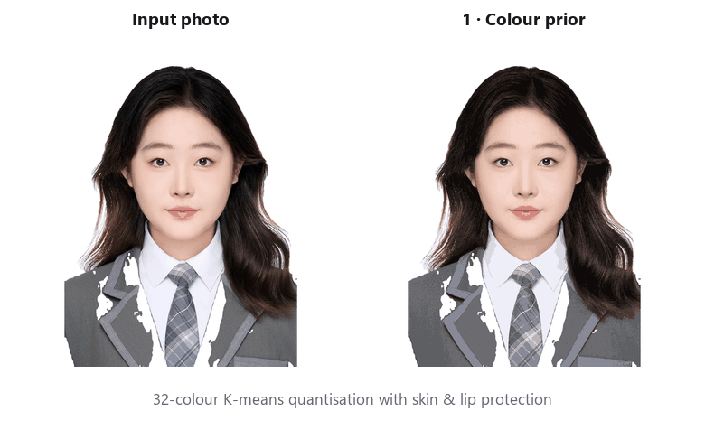
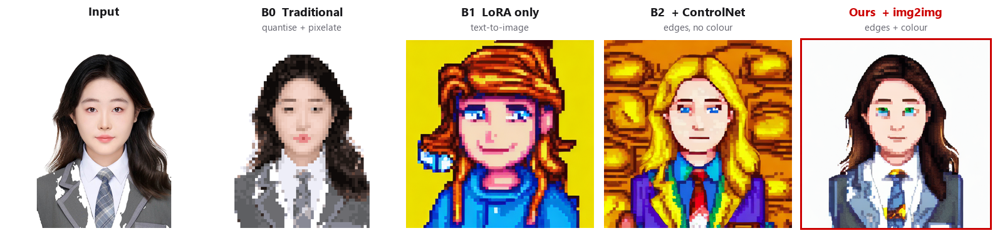
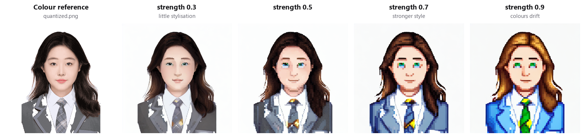

# Photo → Pixel-Art Portrait with Few-Shot Diffusion

MSc dissertation, University of Glasgow (2026): *Decoupling Structure, Style and Colour: A Modular Diffusion Pipeline for Photograph-to-Pixel-Art Conversion under Few-Shot Constraints* · 📄 [Read the dissertation (PDF)](docs/dissertation.pdf)

  

This project turns a portrait photo into a *Stardew Valley*-style pixel-art character while keeping the person recognisable. The style is learned from **30 images** on **one Colab T4 GPU**.

**Stack:** Stable Diffusion 1.5 · LoRA · ControlNet · img2img · SegFormer · CLIP

## Problem

- Diffusion models produce smooth gradients. Pixel art needs a hard grid and a small palette.
- With only 30 training images, the style LoRA **overwrites the model's ability to follow colour words**: a prompt asking for black hair and a white background produced blonde hair and a red background.
- So one text prompt cannot control structure, style and colour together.

## Method

Each factor gets its own control channel:

| Factor | Mechanism |
|---|---|
| **Structure** | Background removal → Canny edge map → **ControlNet** |
| **Style** | **LoRA** (rank 16, 0.46 % of UNet params) trained on 30 hand-captioned portraits in 7 min |
| **Colour** | 32-colour K-means of the photo (skin/lip-weighted) used as the **img2img** starting image |

The result is then snapped to an 8-px grid with nearest-neighbour resampling.

## Results

| Configuration | SSIM ↑ | MAE ↓ | Style dist. (CLIP) ↓ | Identity dist. (CLIP) ↓ |
|---|:---:|:---:|:---:|:---:|
| B0 · Classic pixelation | **0.742** | **8.4** | 0.407 | **0.165** |
| B1 · LoRA only | 0.296 | 107.1 | **0.165** | 0.550 |
| B2 · LoRA + ControlNet | 0.237 | 121.3 | 0.229 | 0.463 |
| **Complete pipeline** | 0.695 | 17.8 | 0.285 | 0.328 |

- **Adding colour conditioning (B2 → complete pipeline)** raises SSIM 2.9× and cuts colour error by 85 %, at a 25 % cost in style distance.
- **The style is easy to learn; keeping the identity is hard.** B1's style distance (0.165) is already within the spread of the real game portraits (0.180).
- **Style and identity trade off against each other.** The complete pipeline is the only configuration that is not extreme on either axis ([trade-off plot](assets/tradeoff.png)).
- **The choice of metric matters.** A colour-histogram metric could not tell classic pixelation apart from the complete pipeline, while CLIP could.

**Key parameter:** img2img `strength` sets how far the output may move from the photo's colours.

| Parameter | Tried | Chosen | Why |
|---|---|:---:|---|
| img2img strength | 0.3 / 0.5 / 0.7 / 0.9 | 0.5–0.6 | Lower values look photographic. At 0.9 hair and clothes change colour |
| ControlNet scale | 0.4 / 0.6 / 0.8 / 1.0 | 0.8 | 0.4 moves facial features. 1.0 flattens hair into blocks |
| Canny thresholds | 50/150 · 100/200 · 150/300 | 100/200 | Low picks up hair texture. High loses facial features |

*Single test subject and seed. See [technical details](docs/DETAILS.md) for all metrics, sweeps, engineering notes and limitations.*

## Run it

Google Colab (T4). Run the notebooks in order: [`01_train_lora`](notebooks/01_train_lora.ipynb) → [`02_preprocess`](notebooks/02_preprocess.ipynb) → [`03_generate`](notebooks/03_generate.ipynb) → [`04_evaluate`](notebooks/04_evaluate.ipynb). Each notebook starts with an install cell; run it, restart the runtime, then continue. Training portraits and LoRA weights are not included because the game art is copyrighted.

---
Code: [MIT](LICENSE). *Stardew Valley* art © ConcernedApe. Not affiliated.
