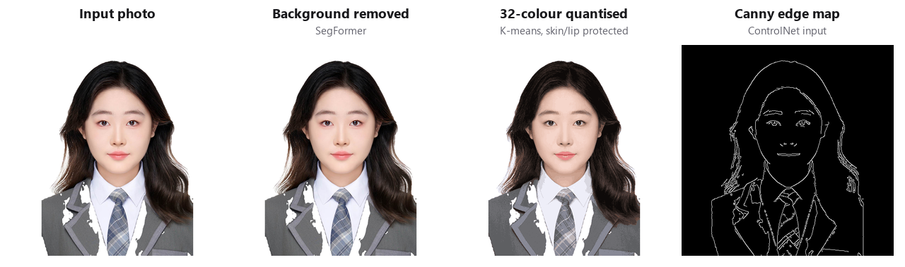
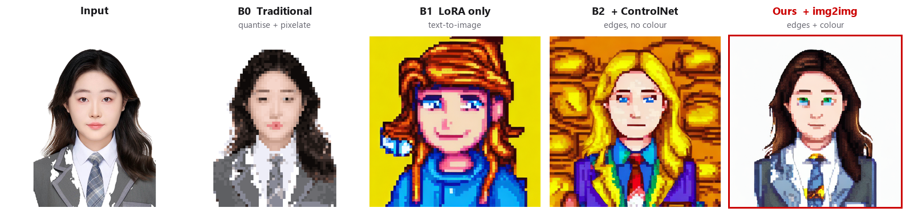
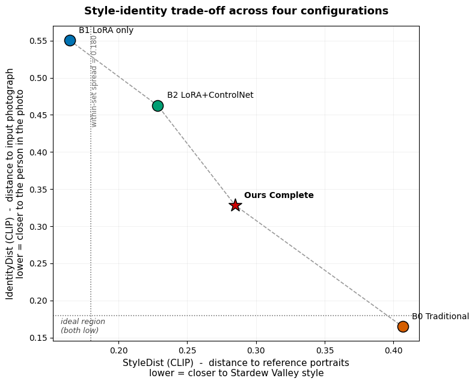
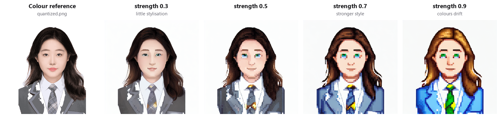

# Technical Details

**Decoupling Structure, Style and Colour: A Modular Diffusion Pipeline for Photograph-to-Pixel-Art Conversion under Few-Shot Constraints**
MSc Computing Science dissertation, University of Glasgow (2026) · 📄 [Full dissertation (PDF)](dissertation.pdf)

Full write-up behind the [project README](../README.md): the failure analysis, every parameter sweep, engineering fixes and limitations. Section numbers below are local to this page.


## 1. Problem

Diffusion models produce smooth gradients and fine texture. Pixel art requires the opposite: a strict grid, a 16–32 colour palette, hard edges and deliberately discarded detail. The goal is to bridge that gap for one specific game style, with very little data:

- **Few-shot style.** Only 30 official portraits exist that fit the target framing.
- **Identity vs. style.** The output has to look like the person *and* like a *Stardew Valley* character.

**The key negative finding.** Once the style LoRA is active, **colour instructions in the text prompt are ignored.** A prompt asking for black hair and a white background produced blonde hair and a saturated red background. Making the prompt longer or adding weighted emphasis did not help; the output collapsed into incoherent colour fields instead. The explanation that fits both observations is overfitting. With 30 images and no regularisation set, the adapter uses its limited capacity to fit the very strong pixel-art signal. In doing so it overwrites the attention pathways that link colour words to image regions. Writing captions with each attribute in a separate tag did not prevent this in the learned model.

**Conclusion:** text cannot carry structure, style *and* colour at once here, so each one needs its own channel.

## 2. Method

```
                 ┌─ SegFormer bg removal → 512² pad ─┬─ K-means (32 colours) ──► img2img init  (COLOUR)
 input photo ────┤                                   └─ bilateral → Canny ─────► ControlNet     (STRUCTURE)
                 └─ minimal prompt "stardew_pixel_art, ..." ───────────────────► SD 1.5 + LoRA  (STYLE)
                                                                                      │
                                                                       8× nearest-neighbour pixelisation
                                                                                      ▼
                                                                              pixel-art portrait
```

<p align="center"></p>

The guiding rule is to **specify exactly whatever can be specified exactly**, and to use learning only for what really needs it, which here is the style.

| Stage | Factor | How |
|---|---|---|
| 1. Style adaptation | **Style** (learned) | LoRA (rank 16, α 16, dropout 0.05) on the attention projections (`to_q/k/v/out`) and transformer `proj_in/out`. Text encoder and VAE are frozen |
| 2. Preprocessing | – | SegFormer person parsing → white background → aspect-preserving pad to 512² → 32-colour K-means → bilateral filter → Canny |
| 3. Conditioned generation | **Structure** | Canny edge map → ControlNet (scale 0.8) |
| | **Colour** | Quantised photo used as the img2img starting image, so sampling starts from the right colours |
| 4. Pixelisation | Grid | Downsample to 1/8 with nearest-neighbour, then upsample the same way, to force a regular pixel grid |

**Dataset.** The source portraits were upscaled with nearest-neighbour interpolation, which keeps hard pixel edges and the exact palette; bilinear or bicubic would blur them. The alpha channel was flattened onto white. An automatic anime tagger was tried first, but at pixel-art resolution it saw shading blocks as objects and sometimes found no person at all. All 30 images were therefore captioned by hand: trigger token, then one tag per attribute ([`scripts/make_captions.py`](../scripts/make_captions.py)).

**Colour prior detail.** Plain K-means gives colours to whatever covers the most pixels, so small regions like the lips lose their tone to hair and clothing. Skin and lip pixels are therefore oversampled ×16 before clustering. This reduced the mean absolute lip-colour error from **23.3 to 14.0** intensity levels.

**Two colour strategies compared.** (a) *Post-hoc palette remap*: every generated pixel is snapped to the nearest colour in the photo palette. This reliably restores the colours, but the palette contains many close skin tones, so the remap brings back smooth gradients and **trades away the style**. (b) *img2img conditioning*: the model starts sampling from a noised copy of the quantised photo, so colour and style are combined during generation. (b) keeps both approximately correct colours and the LoRA's blocky shading, so it is the default. (a) is kept as an option for when exact palette matching matters more.

## 3. Results

Four configurations were compared on the same input, prompt and seed (42). Each one adds a single component to the one before it.

<p align="center"></p>

### Table 1: Ablation across configurations

| Configuration | SSIM ↑ | MAE ↓ | StyleDist HSV ↓ | StyleDist CLIP ↓ | IdentityDist CLIP ↓ |
|---|:---:|:---:|:---:|:---:|:---:|
| B0 · Traditional (quantise + pixelate) | **0.742** | **8.39** | 0.912 | 0.407 | **0.165** |
| B1 · LoRA only | 0.296 | 107.09 | 1.143 | **0.165** | 0.550 |
| B2 · LoRA + ControlNet | 0.237 | 121.34 | 1.347 | 0.229 | 0.463 |
| **Complete pipeline · LoRA + ControlNet + img2img** | 0.695 | 17.78 | **0.909** | 0.285 | 0.328 |
| *Reference: spread within the 30-image style set* | – | – | *0.535* | *0.180* | – |

*SSIM, MAE and IdentityDist are measured against the input photo. StyleDist is measured against the 30 reference portraits: HSV uses their mean histogram, CLIP (ViT-B/32 cosine) is averaged over all 30. The complete pipeline was evaluated at img2img strength 0.6 and before stage-4 pixelisation.*

**Findings**

1. **Colour conditioning has the biggest effect.** B2 → complete pipeline (adding only the img2img colour input) raises SSIM 2.9× (0.237 → 0.695), cuts MAE by 85 % (121.3 → 17.8) and lowers CLIP identity distance by 29 %. It costs 25 % in CLIP style distance.
2. **Learning the style is not the hard part; keeping the identity is.** B1 has a CLIP style distance of 0.165, *below* the 0.180 spread among the reference portraits themselves. In CLIP terms, it is already a plausible *Stardew Valley* portrait.
3. **The choice of metric decides the ranking.** The HSV histogram cannot tell B0 from the complete pipeline: their gap is 0.003, under 1 % of the range across the four configurations. The reason is that both images have similar colour proportions. CLIP distance captures spatial structure, and there the gap is about half the range. **The two metrics rank the four outputs differently at every position.** Pixel art is defined by how colours are arranged in space, so global colour statistics cannot evaluate it.
4. **There is a trade-off frontier, and the ideal corner is empty.** Each extra conditioning signal improves identity and weakens style. No configuration is below the within-set spread on both axes. The complete pipeline is the only one that is not extreme on either axis.

<p align="center"></p>

### Table 2: Parameter sweeps

| Parameter | Values tried | Chosen | Observation |
|---|:---:|:---:|---|
| img2img `strength` | 0.3, 0.5, 0.7, 0.9 | **0.5–0.6** | 0.3 looks like a lightly stylised photo: the grid is barely visible and skin keeps smooth gradients. 0.9 is clearly pixel art, but hair shifts to gold and clothes to saturated blue/green. 0.5 was judged the best compromise visually, and Table 1 was run at 0.6 |
| ControlNet scale | 0.4, 0.6, 0.8, 1.0 | **0.8** | 0.4 moves facial features away from their positions in the photo. 1.0 follows the edges rigidly and flattens the hair into blocks. 0.8 keeps feature placement and still leaves room for the style |
| Canny thresholds | 50/150, 100/200, 150/300 | **100/200** | Low thresholds pick up hair texture. High thresholds keep only the silhouette and lose the facial features. The middle setting keeps eyes, nose, mouth and garment edges |
| Skin/lip oversampling | ×1, ×16 | **×16** | Lip-colour error 23.3 → 14.0 |
| LoRA training | lr 1e-4 × 450 steps / 5e-5 × ~900 steps | **longer, lower lr** | Both learn the texture. Regular pixel cells only appear with longer training, which suggests the shorter run was undertrained rather than at capacity |
| Fixed settings | – | – | LoRA scale 0.8 · 32 colours · 30 sampling steps · CFG 7.5 · 8-px pixel cells |

<p align="center"></p>

### Table 3: LoRA training (run logged in `notebooks/01_train_lora.ipynb`)

| Setting | Value |
|---|---|
| Base model | `runwayml/stable-diffusion-v1-5` |
| Images / resolution | 30 / 512 × 512 |
| Epochs / batch / steps | 30 / 2 / 450 |
| Optimiser | AdamW, lr 5e-5, cosine schedule, 50 warm-up steps, weight decay 0.01 |
| Precision | fp16 mixed precision with gradient checkpointing (LoRA params in fp32) |
| Trainable params | 3.99 M / 863.5 M (0.46 %) |
| Time / output | 7.1 min on a Tesla T4 / 16 MB `.safetensors` |

## 4. Repository structure

```
notebooks/
  01_train_lora.ipynb    LoRA training on the 30-image style set (+ sanity-check generation)
  02_preprocess.ipynb    Background removal → padding → colour quantisation → Canny
  03_generate.ipynb      ControlNet + img2img + LoRA generation, strength sweep
  04_evaluate.ipynb      B0/B1/B2/complete ablation, HSV + CLIP metrics, trade-off plot
scripts/
  make_captions.py       Writes the 30 hand-written caption files
assets/                  Figures and demo GIF used in this README
requirements.txt
```

## 5. Running it

The notebooks are written for **Google Colab with a T4 GPU**. Each starts with an install cell. Run it, then **Runtime → Restart runtime**, then run the remaining cells in order.

1. `python scripts/make_captions.py --out data/train`, then put the 30 matching `.png` portraits in the same folder and zip it.
2. `01_train_lora.ipynb`: upload the zip and train. This produces `stardew_pixel_lora_final.safetensors`.
3. `02_preprocess.ipynb`: upload a portrait photo. This produces `quantized.png`, `canny_final.png` and `portrait_512.png`.
4. `03_generate.ipynb`: upload the outputs of steps 2–3 and generate.
5. `04_evaluate.ipynb`: upload the same files plus the training zip to reproduce Table 1.

The training portraits are not included because the game art is copyrighted. The LoRA weights are not included either.

## 6. Engineering notes

- **Dependency conflicts.** `diffusers` 0.27.2 imports a function that newer `huggingface_hub` releases removed. Fix: install hub 0.21.4 *first*, then install diffusers with `--no-deps` so pip can't upgrade the hub again. Colab's numpy 2.x breaks `torch.from_numpy`, so numpy is pinned to 1.26.4. That in turn breaks torchvision, so the data pipeline was rewritten with PIL only.
- **fp16 training.** After `get_peft_model`, only the LoRA parameters are cast to fp32. This fixes the `GradScaler` error on fp16 gradients, while the frozen network stays in fp16 to save memory.
- **Single-process data loading.** The tokenizer's thread state does not survive `fork`, so multi-worker DataLoaders deadlock silently on Colab. With 30 images, `num_workers=0` costs almost nothing.
- **Manual LoRA merge.** That diffusers version has no LoRA loader on the UNet, so weights are merged as `W ← W + s · (B @ A)`. Flattening to 2D and reshaping back handles linear layers and 1×1 convolutions with the same code.

## 7. Limitations

- **One subject, one seed.** All results come from portraits of one person in similar framing. One non-frontal photo produced a much worse edge map. Visual judgements were made by the author only. CLIP distance has not been checked against human judgement for pixel art.
- **Eye colour is unreliable.** The training portraits draw eyes in a few saturated pixels, and the LoRA seems to treat that as part of the style. At that size the colour conditioning is too weak to override it.
- **Framing.** The reference portraits use large, caricature-like heads. The output keeps the photo's framing because ControlNet copies it.
- **Segmentation.** The clothing-parsing model sometimes cuts away regions where dark hair meets dark clothing (white patches in the figures). A portrait-matting or salient-object model (e.g. U²-Net) would be a drop-in replacement.

**Future work:** a user study to validate the CLIP metric. A dataset-size ablation (15/30/60 images) to test whether prompt colour control returns with more data. Portrait matting. A reframing step to match the game's composition.

## License & acknowledgements

Code is released under the [MIT License](../LICENSE). *Stardew Valley* and its character art are © ConcernedApe. This is a non-commercial academic project and is not affiliated with ConcernedApe. No game assets are distributed here.

MSc Computing Science project, School of Computing Science, University of Glasgow. Thanks to my supervisor for suggesting that colour be moved into the generation step.
